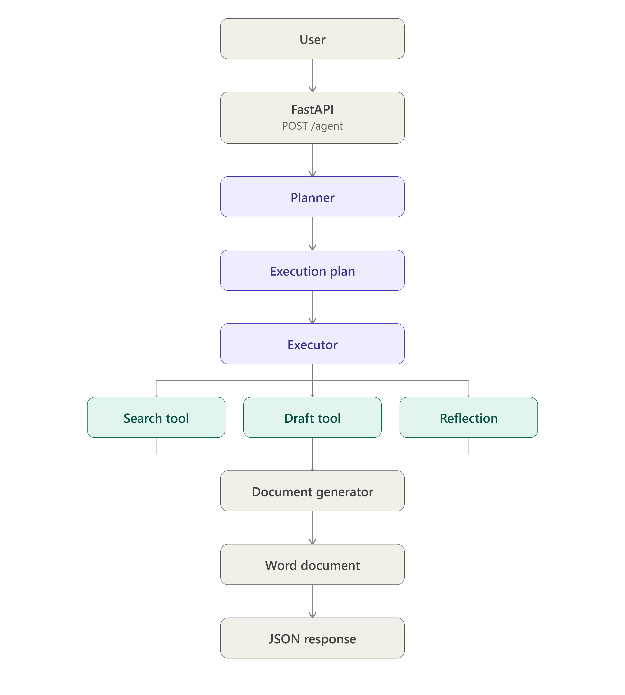

# Autonomous Agent System

A production-ready, highly resilient, multi-agent AI system designed to autonomously plan, research, draft, self-check, and compile comprehensive Word reports (`.docx`) using Google Gemini and LangGraph.

---

## 🏗️ System Architecture & Workflow

The system is exposed as a REST API using **FastAPI** that triggers an orchestrator coordinating multiple specialized AI components in a structured lifecycle.



### Text Flow Representation

```
User ──► POST /agent ──► FastAPI ──► Planner (LangGraph) ──► Execution Plan (DAG)
                                                                  │
┌─────────────────────────── Executor (PlanExecutor) ◄────────────┘
│     │
▼     ▼
Search   Batch Draft ──► ReflectionAuditor (Self-Healing Loop) ──► compile_document (DocxBuilder)
                                                                       │
                                                                       ▼
                                                             Word Document (.docx)
```

---

## 🔄 Agent Lifecycle & Implementation Details

The core automation agent is split into four distinct phases, implemented with separation of concerns:

### 1. Planning Phase
The [AutonomousPlanner](app/agent/planner.py) manages a LangGraph state machine flow:
- **`detect_document_type` Node**: Analyzes the request to determine document category (e.g. Standard Operating Procedure, Technical Specification, Business Proposal) and suggests an outline structure.
- **`generate_task_plan` Node**: Creates a directed acyclic graph (DAG) of tasks to gather research, write each section, and audit the results.
- **`compile_and_validate` Node**: Performs cycle detection using Depth-First Search (DFS) in `_has_cycles()` to clear invalid dependencies and avoid runtime deadlocks.

### 2. Execution Phase
The [PlanExecutor](app/agent/executor.py) processes the execution graph:
- It tracks execution state and identifies "ready" tasks whose dependencies are successfully completed.
- **Performance Optimisation**: To respect free-tier RPM/TPM rate limits and reduce user latency, the executor groups all `draft_section` tasks and runs a batch execution query (`_run_batch_draft`), generating all sections in a single prompt.

### 3. Reflection & Self-Healing Phase
The [ReflectionAuditor](app/agent/reflection.py) acts as a strict Quality Assurance reviewer:
- Audits compiled drafts for empty sections, logical gaps, and placeholder expressions (e.g., `[Insert Name]`, `TODO`, `XXX`).
- If the quality score falls below 80, the auditor rejects the draft, lists the required corrections, and triggers a single-prompt batch self-healing prompt to automatically rewrite the faulty sections.

### 4. Document Compilation
The [DocxBuilder](app/tools/doc_generator.py) compiles the final document:
- Applies a unified layout with 1-inch margins, custom colors (Navy primary, Slate secondary, Charcoal body text), and Calibri font.
- Creates a cover page, dynamically inserts page numbers in footers, and builds tables with colored headers.
- Implements a resilient file-saving mechanism that sanitizes invalid Windows path characters and uses unique fallback names if files are locked or inaccessible.

---

## 📂 Project Directory Map

```
automation_agent/
├── app/
│   ├── agent/
│   │   ├── executor.py
│   │   ├── planner.py
│   │   └── reflection.py
│   ├── core/
│   │   ├── config.py
│   │   └── models.py
│   ├── tools/
│   │   ├── agent_tools.py
│   │   ├── base.py
│   │   ├── doc_generator.py
│   │   └── search.py
│   ├── llm.py
│   └── main.py
├── tests/
│   ├── run_integration_tests.py
│   ├── test_fallback.py
│   ├── test_filename.py
│   └── verify_debug.py
├── .gitignore
├── README.md
├── ai_agent_architecture_flow.png
├── flow.txt
├── requirements.txt
├── strategic_business_report.docx
└── verify_gemini.py
```

- **[app/main.py](app/main.py)**: FastAPI entrypoint containing `/agent` orchestrator and `/download/{filename}` endpoints.
- **[app/llm.py](app/llm.py)**: Low-level wrapper client for the Google Gemini API, including Pydantic-based structured response validation and retry handling on HTTP 429 quota exhaustion.
- **[app/core/](app/core)**: Pydantic-based configuration schemas and domain data models.
  - [config.py](app/core/config.py): Environment settings loader.
  - [models.py](app/core/models.py): Domain models for `Task`, `ExecutionPlan`, `AgentRequest`, and `DocumentMetadata`.
- **[app/agent/](app/agent)**: Core multi-agent logic scripts.
  - [planner.py](app/agent/planner.py): LangGraph planning workflow.
  - [executor.py](app/agent/executor.py): Dependency execution loop.
  - [reflection.py](app/agent/reflection.py): QA checks and self-healing.
- **[app/tools/](app/tools)**: Dynamically registered tools using decorators.
  - [base.py](app/tools/base.py): Thread-safe `ToolRegistry`.
  - [agent_tools.py](app/tools/agent_tools.py): Registers the `draft_section` and `reflection_check` tools. Includes professional markdown fallbacks when the LLM is unavailable.
  - [search.py](app/tools/search.py): Registers the `web_search` tool wrapper using DuckDuckGo.
  - [doc_generator.py](app/tools/doc_generator.py): Registers `compile_document` wrapper using python-docx.
- **[tests/](tests)**: Quality assurance testing suite.
  - [run_integration_tests.py](tests/run_integration_tests.py): Executes integration test queries against the running server.
  - [test_fallback.py](tests/test_fallback.py): Tests quota resiliency fallback procedures when live API calls return 429.
  - [test_filename.py](tests/test_filename.py): Validates Windows filename sanitization.
  - [verify_debug.py](tests/verify_debug.py): Direct debugger execution script.

---

## ⚙️ Configuration & Setup

1. **Install Dependencies**:
   ```bash
   pip install -r requirements.txt
   ```

2. **Configure Environment Variable**:
   Create a `.env` file in the root workspace directory:
   ```env
   APP_NAME="Autonomous Agent"
   APP_VERSION="1.0.0"
   LOG_LEVEL="INFO"
   GEMINI_API_KEY="YOUR_GOOGLE_STUDIO_API_KEY"
   DEFAULT_MODEL="gemini-1.5-flash"
   OUTPUT_DIR="outputs"
   ```

3. **Verify Gemini API connection**:
   ```bash
   python verify_gemini.py
   ```

---

## 🚀 Running the Server

Start the API service locally using Uvicorn:
```bash
uvicorn app.main:app --host 127.0.0.1 --port 8000 --reload
```

Open your browser to `http://127.0.0.1:8000/docs` to explore the interactive Swagger documentation.

---

## 🧪 Testing

Run unit and integration tests using python's `unittest` module or execution scripts:

### 1. Run Unit Tests (Resiliency & Sanitization)
```bash
python -m unittest tests/test_fallback.py tests/test_filename.py
```

### 2. Run API Integration Tests
Start the server first:
```bash
uvicorn app.main:app --host 127.0.0.1 --port 8000
```
Then, in another terminal window, run the integration test runner:
```bash
python tests/run_integration_tests.py
```
